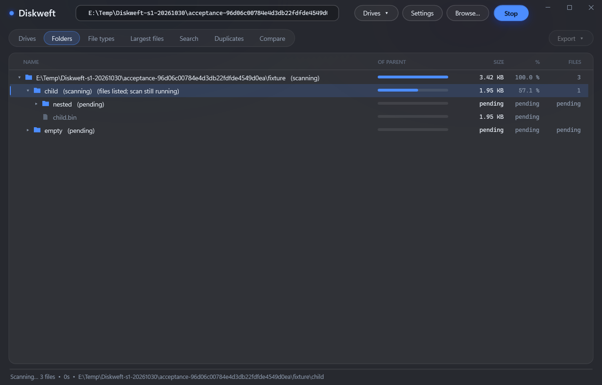

# S1: independent identity and classic live scanning

Verified 2026-10-30. Scope: S1 only. Internal version
`0.0.1-stage1-development`, file/assembly version `0.0.1`.

S1 source/evidence commit `36e4f3a6d0ceac7758573344953d3b3f515f9cea`
was pushed to `Darkaxt/Diskweft` master. GitHub bridge commit/blob read-back and
`git ls-remote` independently matched local HEAD and key source/document blobs.
All assigned S1 criteria passed; no S1 blockers or tracked deferrals remain.

## Implemented workflow

The ordinary scan publishes consistent directory totals and bounded statistics
through a coalesced mailbox. The dispatcher projects these into its own nodes and
preserves row identities. A 500 ms result timer is separate from the existing
200 ms status timer; final reconciliation does not wait for a timer tick.

Folder expansion enumerates files off the dispatcher, uses request/generation
identity, and retains at most 1,000 file entries plus a summary per listing.
Stop/restart, subtree rescans and native close follow actual worker completion.
Partial snapshots retain their outcome and do not become automatic complete
history. A completed subtree cannot promote an otherwise stopped full tree.

Diskweft has its own executable/icon, profile under `Darkaxt/Diskweft`, registry
identity, shell verbs, ecosystem card, updater feed and installer AppId. Upstream
data migration and forced process termination were removed from the fork's
installer configuration. S5 owns the separately requested system replacement.

## Verification evidence

`scripts/Invoke-Stage1Checks.ps1` built the normal and test variants and executed
`tests/Stage1Tests.cs`. The final operation exited 0. It verified:

- Real filesystem parent totals and extension/largest-file publication while an
  unfinished child was paused at an event barrier; no arbitrary test sleeps.
- Exact controlled totals, restart, name/path exclusions, virtual multiple-root
  aggregation, native long paths and a real fixture DACL denial. The original
  DACL was restored in `finally` and no test deny rule remained.
- A 2,100-file case with a single directory update and a 1,000-file largest list;
  this is bounded-state evidence, not a million-file performance benchmark.
- A read-only actual UNC share scan and real unprivileged raw-volume denial
  followed by classic root enumeration/cancellation. Existing system-root reparse
  directories were excluded. No administrator action or whole-host scan ran.
- Native WPF Scan/Stop, keyboard expansion, asynchronous listing, selection,
  search, subtree rescan and correct history. A deliberately delayed old listing
  was discarded after restart. Native close waited for all owned threads.
- Native Scan-all button wiring against controlled real filesystem roots, and
  real virtualized scrolling through a 2,100-file listing. File-row selection and
  scroll offset survived terminal reconciliation and relisting.
- Classic search and actual duplicate hashes, explicit legacy snapshot loading
  and comparison with `legacy-unknown` completeness, and failed/stopped provenance.
- Local HTTP updater fixtures rejected upstream/foreign assets and accepted the
  fork's own asset identity. No installer was downloaded or executed.
- Isolated SpaceScan legacy/shared profile and Pathweft sentinels remained exact;
  Diskweft's own card/profile were used independently.

The final controlled native observation was **499.063 ms** from publication at
the real-metadata test barrier to the UI receiving useful partial results. This
uses a real monotonic clock but a paused fixture; it is not whole-drive scan
throughput or physical-display presentation latency. The scroll capture had
1,002 projected rows, 24 mounted containers, offset 32 and no diagnostic truncation.

`tests/Verify-NormalBuild.ps1` independently launched the normal build and the
retained SpaceScan baseline on identical unchanged controlled data. CSV output
matched exactly; Diskweft HTML identity passed. It also checked the normal updater,
profile/shell identity, absent test hooks, isolated installer source and unchanged
actual upstream registry/settings/card bindings. The operation exited 0.

Normal executable SHA-256:
`65597f474952c189d09c8dafb9cebec110e2d933fcf5f13a5143d6a4f9774c1d`.
The retained development executable was copied from this verified output and its
hash independently matched. No application installation or system routing changed.
Authenticode status is `NotSigned`; no signing certificate or trust configuration
was created or changed.

## Native rendering

This is the instantiated native WPF application rendered from an offscreen window,
using generated fixture paths. It demonstrates partial/pending state and live
navigation in the inherited appearance. It is not a Windows-theme redesign,
physical focus/hotkey test, or DWM screenshot. Structured diagnostics distinguish
projected rows from actual mounted visual containers.

## Retention and limits

Ignored `.local/s1/` retains final JSON observations, source hashes and selected
native captures for S2-S4 regression/reference use. Ignored `.local/development/`
retains the current usable development executable and MIT notice. These are
intentional current project assets; disposable build/test trees are cleaned.

Transactional cleanup applied signed reviewed inventories after all original
consumers exited. The initial S1 transaction
`b808c7a79e9998b95ff7e098c3801407` removed 8,714 members / 4,608,963 logical
bytes. Final compatibility transaction `cdd3154a46cd1879dee43d430528af31`
removed 4,319 members / 2,320,438 logical bytes. Exact D: build and E: test
scratch roots were confirmed absent. Separate completed inspection-script
transactions `81824a9d2d852c74f247f4c20124dd96` and
`8a41326c1c54495f5ecb225ddd9e2d95` removed their two reviewed members each.
All returned `applied` with no exclusions, errors or residuals. The actual
fixture ACL was restored; no elevation or policy bypass was used.

Progressive MFT results, Windows light/dark/accent styling, large-volume performance
qualification, final installer/package behavior and published product delivery
remain S2-S4. The existing MFT finalizer only gained per-directory extension
metadata needed to seed correct S1 rescans; its streaming UI is not implemented.
S5 system replacement is documented and NOT STARTED. No product release is
claimed by this stage's source publication.
